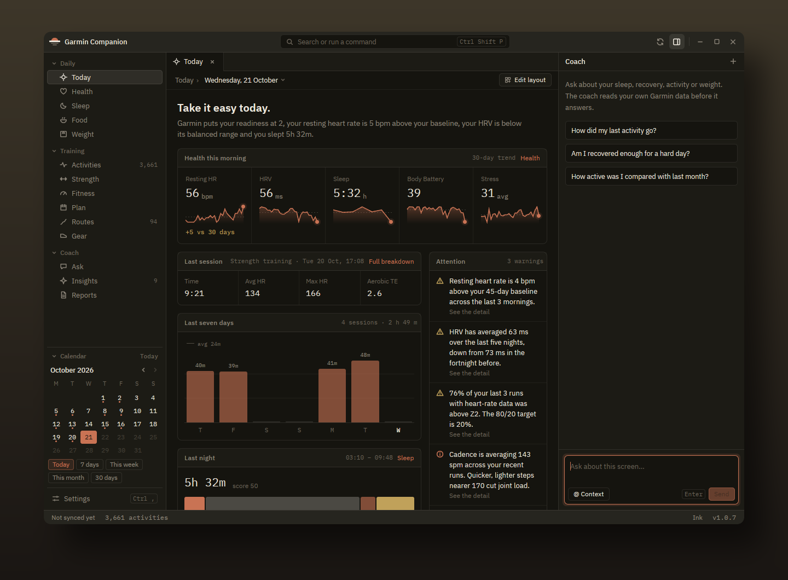
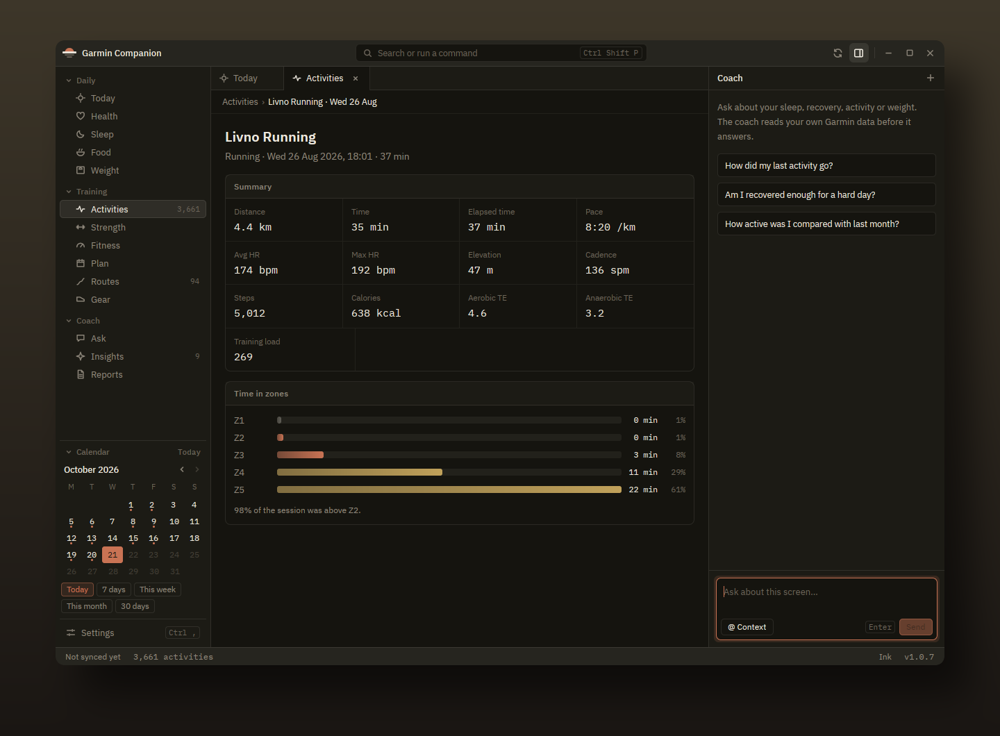
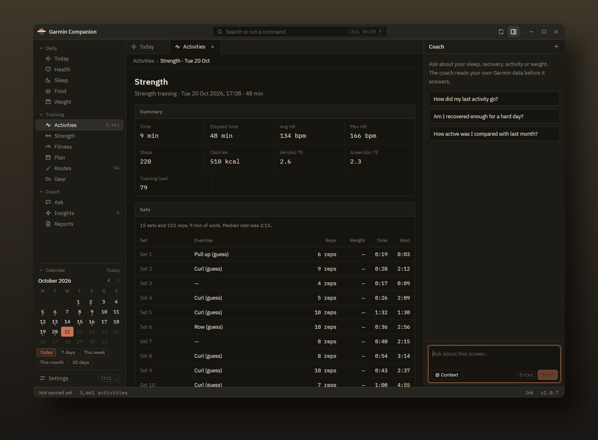
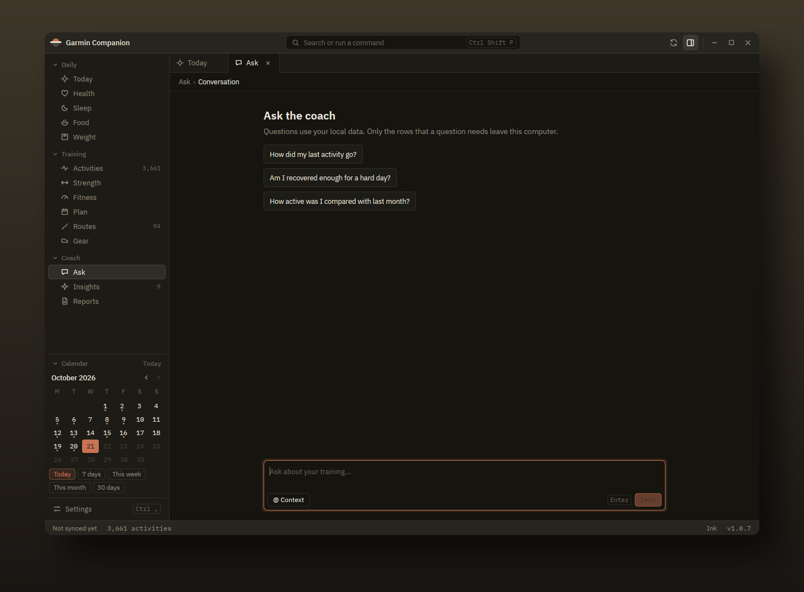
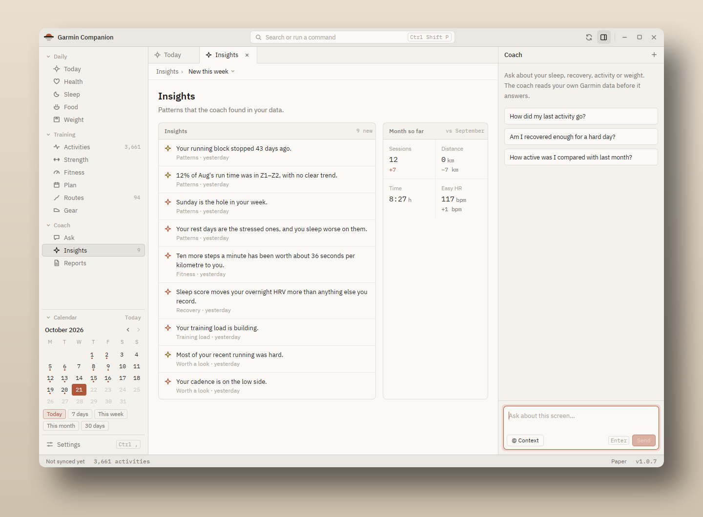
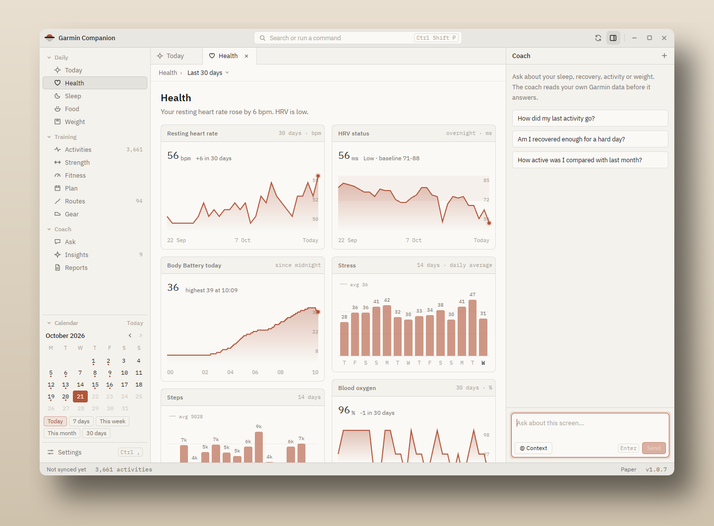
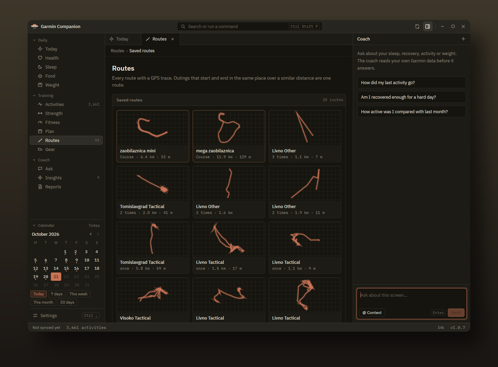

# Garmin Companion

Garmin Companion copies your Garmin Connect history to your computer or phone.
It shows the data in more detail than the Garmin app, and it answers questions
about the data. It shows where your heart rate was during each session.

It also has an MCP server, so Claude Desktop can read the same data.



## Download

**Desktop**

[](https://github.com/omznc/garmin-companion/releases/latest/download/garmin-companion_x64-setup.exe)
[](https://github.com/omznc/garmin-companion/releases/latest/download/garmin-companion_aarch64.dmg)
[](https://github.com/omznc/garmin-companion/releases/latest/download/garmin-companion_x64.dmg)
[](https://github.com/omznc/garmin-companion/releases/latest/download/garmin-companion_amd64.deb)
[](https://github.com/omznc/garmin-companion/releases/latest/download/garmin-companion.x86_64.rpm)
[](https://github.com/omznc/garmin-companion/releases/latest/download/garmin-companion_amd64.AppImage)

**Mobile**

[](https://github.com/omznc/garmin-companion/releases/latest/download/garmin-companion.apk)
[](https://github.com/omznc/garmin-companion/releases/latest/download/garmin-companion_unsigned.ipa)

All the files, and the older versions, are on the
[releases page](https://github.com/omznc/garmin-companion/releases).

The files do not have a signature from Apple, Microsoft or Google. Thus, each
system shows a warning at the first install:

- **macOS:** Move the app to Applications. Then run this command one time:

  ```sh
  xattr -dr com.apple.quarantine "/Applications/Garmin Companion.app"
  ```

- **Windows:** SmartScreen shows "unrecognised app". Click **More info**, then
  **Run anyway**.
- **Linux:** The `.deb` and `.rpm` need `webkit2gtk-4.1`. For the AppImage,
  run `chmod +x` on the file, then open it.
- **Android:** Android 7 or later. Let your browser or file manager install
  apps.
- **iOS:** The `.ipa` has no signature. Sign and install it with
  [Sideloadly](https://sideloadly.io) or [AltStore](https://altstore.io). It
  does not update itself.

After the first install, the desktop and Android apps update themselves. Each update has a signature
from this project, and the app checks it.

## Screens

- **Today:** the week against your goals, the coach's brief, recovery, and the
  last session with its heart-rate zones.
- **Activities:** the history. One session shows laps, splits and charts.
- **Health:** resting heart rate, HRV, sleep, stress and Body Battery.
- **Sleep:** the stages of last night, heart rate, HRV, respiration and SpO2,
  and the bedtime over a period.
- **Food:** calories in and out, and hydration.
- **Ask:** questions about your data, to a model that you select.
- **Strength:** each set, with reps, work time and rest time.
- **Fitness:** Garmin's training status, load, race predictions and personal
  records.
- **Insights and Reports:** correlations with their sample size, and weekly
  summaries.
- **Plan, Routes and Gear:** saved workouts, routes from your GPS tracks, and
  shoe and bike distance.
- **Export:** activities to CSV, and reports to PDF.

| A session | A strength session | Ask |
|---|---|---|
| [](docs/screenshots/activity-dark.png) | [](docs/screenshots/activity-strength-dark.png) | [](docs/screenshots/ask-dark.png) |

| Insights | Health | Routes |
|---|---|---|
| [](docs/screenshots/insights-light.png) | [](docs/screenshots/health-light.png) | [](docs/screenshots/routes-dark.png) |

More screenshots are in [`docs/screenshots`](docs/screenshots).

## Your data

The app keeps your data in a local SQLite file. Only the sync connects to
Garmin, and it connects directly, not through a server of this project.

- On the desktop, your Garmin credentials are in the keyring of the system.
- The Ask screen sends your question and the summary rows that it needs. It
  never sends the full database or your GPS tracks. You select where it goes:
  - **Built-in coach** (default): through a small proxy of this project, to a
    hosted model. The proxy keeps no data. Its code is in [`worker/`](worker).
  - **OpenRouter**, with your own key.
  - **Ollama**, on your computer. No data leaves the computer.
  - **Claude Code**, **OpenCode** or **Codex** (desktop only): the app starts
    the command, and gives it read-only tools over MCP.
- To remove all the data, delete the SQLite file. Settings shows its path.

## The coach

One time each day, the coach writes a short brief about your sleep, recovery,
training and goals. Each statement shows the numbers that it comes from. The
coach sends a notification only on days when the brief is important.

The rules in `crates/garmin-core/src/coach.rs` find the facts. A model writes
the text. If no model is available, the rules write the text.

## Build from source

The desktop app needs Rust. On Linux, it also needs the packages that
`.github/workflows/ci.yml` installs.

```sh
cargo build -p garmin-companion-login && cargo run -p garmin-companion-desktop
```

The Android and iOS app is in `apps/mobile` (Expo). It needs Node 22 or later
and pnpm. For Android, also install the SDK, NDK 28 and a JDK 21 or earlier:

```sh
source scripts/android-env.sh
cd apps/mobile && pnpm install
```

To sync from the command line, for example from cron:

```sh
cargo run -p garmin-core --bin sync -- 30          # the last 30 days
cargo run -p garmin-core --bin sync -- 365 --full
```

## MCP server

`crates/garmin-mcp` gives the same queries as MCP tools. It uses the same
client, token store and cache as the app. `manifest.json` describes it for
Claude Desktop.

```sh
cargo build --release -p garmin-mcp
./target/release/garmin-mcp import   # use your existing tokens, one time
./target/release/garmin-mcp coach    # the coach's brief for today
```

## Layout

| Path | Contents |
|---|---|
| `crates/garmin-core` | Garmin client, token store, SQLite cache, sync, queries |
| `crates/garmin-mcp` | MCP server |
| `crates/garmin-api`, `crates/garmin-coach` | Garmin API types, coach logic |
| `apps/desktop` | The desktop app (gpui) and its packages |
| `apps/login` | The sign-in window of the desktop app |
| `apps/mobile` | The Android and iOS app (Expo) |

To make a release, see [RELEASING.md](RELEASING.md).

## Licence

MIT. See [LICENSE](LICENSE).
